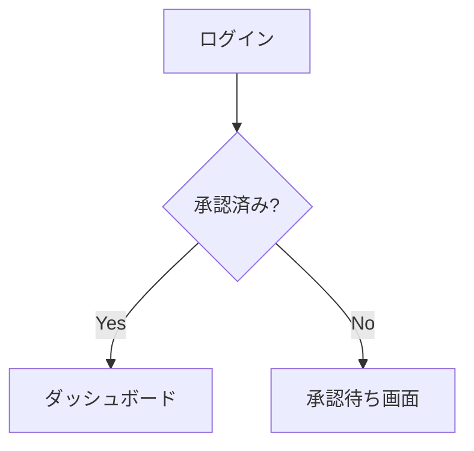

## 概要

本記事は、[チーム開発記録6：動画詳細ページのリリースと承認機能の開発着手](https://zenn.dev/singularitylabs/articles/a0088b1813e327)に続く最新の活動記録です。

今回の会議では、動画ページ作成が完了し **ver2 のリリース**が確認されました。また、担当メンバーが作成した PlantUML の画面構成図について、Mermaid との比較やメンテナンス性の観点から設計書の方針を見直す議論が中心となりました。

* チーム開発方針については、[こちら](https://zenn.dev/singularitylabs/articles/20123b869b7e6a)をご参考ください
* 技術スタックは[こちら](https://github.com/Singuralitylabs/portal-site/wiki)をご参考ください
* 開発しているポータルサイトのGithubリポジトリは[こちら](https://github.com/Singuralitylabs/portal-site)です

## 開発したもの

### ver2 リリース完了

動画一覧・動画詳細ページの実装が完了し、本番環境への反映が確認されました。現在は UI/UX エンハンスメントのイシューを整理しながら、プロフィール機能・承認機能の開発を並行して進めています。

### 機能仕様書へのプロフィールページ追加（PR #105）

`users` テーブルへの `bio`（自己紹介文）カラム追加と、プロフィールページの仕様が設計書に追記されました。

```markdown
### プロフィールページ仕様

**表示項目：** 名前・役割・参加日・自己紹介
**編集可能項目：** 名前（display_name）・自己紹介（bio）
**保存処理：** 「保存」ボタンクリックでトースト通知を表示
```

```sql
-- users テーブルへの追加カラム
bio  VARCHAR(500)  -- ユーザーの自己紹介文
```

### 動画一覧のページ内遷移仕様追加（PR #119）

動画一覧・資料一覧のページ上部にカテゴリーショートカットを表示する仕様が機能仕様書に追加されました。

```markdown
### 動画一覧 ページ内遷移

- ページ上部に各カテゴリーへのショートカットを表示
- 例: | プログラミング学習 | 交流会 | ... |
- クリックで対応カテゴリーセクションまでスクロール
```

## 会議の様子

### PlantUML vs Mermaid：設計書のメンテナンス性を議論

担当メンバーが画面遷移を表す構成図を PlantUML で作成しました。視覚的な分かりやすさは高く評価されましたが、以下の課題が指摘されました。

**問題点：**
- PlantUML は外部サイト（PlantUML 公式サーバー）でレンダリングした画像を埋め込む形式のため、**GitHub 上で直接プレビューできない**
- 「PlantUML を書ける人しか修正できない」というメンテナンス性の問題
- ページやボタンが増えるたびに図が横に広がり、管理が煩雑になる

**議論の結論：**
- もともと Mermaid を採用していた理由は「GitHub との相性の良さ（Markdown 内で直接プレビューできる）」にあった
- 図を別ファイル（Draw.io など）で管理する案も出たが、これも同様のメンテナンス性問題がある
- 担当メンバーの提案を受け、PlantUML の構成図を削除してテキスト形式の機能仕様書に統一する方針に決定

### 設計書はテキスト形式で管理する方針の確認

チームとして「設計書は誰でも読み書きできるテキスト（Markdown）形式で管理する」という原則を再確認しました。視覚的な表現よりも、チーム全員がメンテナンスしやすいことを優先する判断です。図が必要な場合は Mermaid を使い、GitHub 上で直接プレビューできる形を維持します。

### 並行プロジェクトの進捗確認

- **プロフィール機能**：設計書の仕様追加が進んでいる（PR #105）
- **承認機能**：実装を進めている状況
- **UI/UX エンハンスメント**：パフォーマンスではなく UI 改善を優先する方針で Issue を整理中

## 活用した技術

### Mermaid（GitHub 内 Markdown 図）

Mermaid は Markdown のコードブロック内に記述するだけで GitHub 上でフローチャートや ER 図を描画できるツールです。PlantUML より表現力は低い部分もありますが、外部ツール不要・編集のしやすさが大きなメリットです。



### Supabase マイグレーション

テーブルへのカラム追加はマイグレーションファイルで管理します。今回は `users` テーブルへの `bio` カラム追加が計画されています。既存データに影響しないよう `NULL` 許容で追加し、必要に応じてデフォルト値を設定します。

## 総括

ver2 のリリースという大きな節目を迎えました。設計書のメンテナンス性に関する議論を通じて、「誰でも触れる」ドキュメント管理の重要性をチームで再確認できました。プロフィール機能・承認機能の実装も着実に進んでおり、次のステップが見えてきています。

シンギュラリティ・ラボでは、このような実践的なチーム開発に参加していただける仲間を随時募集しています。初心者の方も歓迎ですので、ご興味があればぜひお気軽にご参加ください。

---

## プログラミングイベントのご案内

毎月数回、GASを中心としたプログラミングを学べるオンライン講座を開催しております。直接学びたい方はぜひご参加ください。
申し込みフォームは[こちら](https://forms.gle/gc5F2PZC1mkwZAc27)
過去のプログラミングイベントの紹介は[こちら](https://sinlab.future-tech-association.org/school/)

## GASアプリ開発サービスのお知らせ

シンギュラリティ・ラボでは、GASを中心としたWebアプリ開発のご相談を受け付けております。
普段の作業のちょっとした自動化から自分やチーム専用のカスタムアプリまで、ぜひお気軽にお問い合わせください。
詳細は[こちら](https://appdev.future-tech-association.org/)

## シンギュラリティ・ラボのご案内

オンラインサロン「シンギュラリティ・ラボ」（通称シンラボ）では、さまざまなITスキルを学び、チーム開発に取り組む仲間を募集しております。 初心者から経験者まで、どなたでも参加可能です。
少しでも興味がございましたらお気軽にお越しください。

シンギュラリティ・ラボのHPは[こちら](https://sinlab.future-tech-association.org/join)

お問い合わせ先 sinlab-recruit@future-tech-association.org
