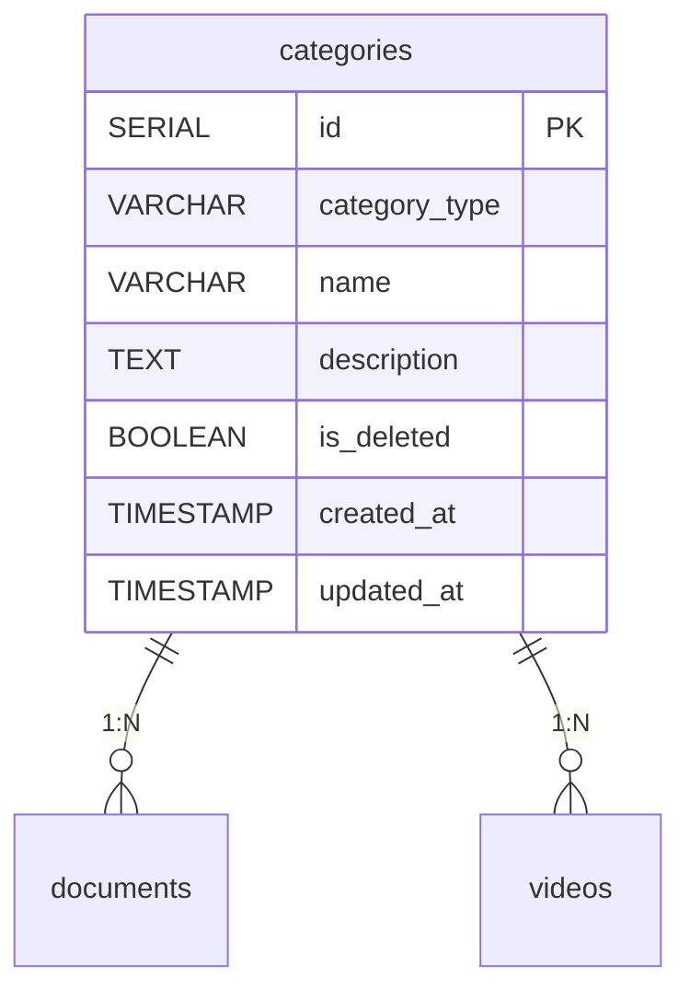

## 概要

本記事は、[チーム開発記録8：動画サムネイル表示とカテゴリーテーブル設計](https://zenn.dev/singularitylabs/articles/6916687843f809)に続く最新の活動記録です。

今回の会議では、動画一覧への**サムネイル表示対応**のコードレビューを行い、マージ判断を行いました。また、**カテゴリーテーブルの設計**について、ID採番方針やカラム構成に関する詳細な議論を行いました。さらに、機能仕様書において設計書の認証機能をSupabase Authへ変更する方針も確認しました。

* チーム開発方針については、[こちら](https://zenn.dev/singularitylabs/articles/20123b869b7e6a)をご参考ください
* 技術スタックは[こちら](https://github.com/Singuralitylabs/portal-site/wiki)をご参考ください
* 開発しているポータルサイトのGithubリポジトリは[こちら](https://github.com/Singuralitylabs/portal-site)です

## 開発したもの

### カテゴリーテーブルの設計定義とDB設計書更新（PR #118）

動画・資料を種別ごとに分類・管理するための `categories` テーブルが設計書に追加されました。`documents` テーブルと `videos` テーブルの `category` カラムも `VARCHAR` から `category_id INTEGER FOREIGN KEY(categories.id)` に変更されています。

```sql
-- categories テーブル定義
CREATE TABLE categories (
  id            SERIAL PRIMARY KEY,
  category_type VARCHAR(50)  NOT NULL, -- 'documents' OR 'videos'
  name          VARCHAR(100) NOT NULL,
  description   TEXT,
  is_deleted    BOOLEAN      DEFAULT FALSE NOT NULL,
  created_at    TIMESTAMP    DEFAULT CURRENT_TIMESTAMP NOT NULL,
  updated_at    TIMESTAMP    DEFAULT CURRENT_TIMESTAMP NOT NULL
);
```

```sql
-- documents テーブル: category カラムを category_id に変更
ALTER TABLE documents
  ADD COLUMN category_id INTEGER REFERENCES categories(id) NOT NULL;

-- videos テーブル: category カラムを category_id に変更
ALTER TABLE videos
  ADD COLUMN category_id INTEGER REFERENCES categories(id) NOT NULL;
```

また、ER図も Mermaid 形式で更新され、`categories` テーブルと `documents`・`videos` テーブルの1対多の関係が明示されました。



## 会議の様子

### 動画サムネイル表示対応のコードレビュー

前回に引き続き、動画サムネイル表示対応のコードをレビューし、マージ可否を判断しました。

担当メンバーが実装した内容は、YouTube の動画 ID を URL から抽出してサムネイル URL を生成する関数を `utils.ts` に切り出したものです。

**React の命名規則の確認**：レビュー中に、関数名が大文字始まりになっている箇所が指摘されました。React では JSX を返す**コンポーネント関数**は大文字始まり、URLや文字列を返す**通常の関数**は小文字始まりにするのが慣習です。担当メンバーはその場でリアルタイムに修正対応しました。

ビルド確認も済んでいたことから、コードレビューでの問題なしと判断し、マージを進める方針となりました。

### カテゴリーテーブルの設計議論

担当メンバーが作成したカテゴリーテーブルの設計について、チームで詳細な議論を行いました。

**ID採番方針の議論**：当初、資料カテゴリーを100番台・動画カテゴリーを200番台にする番号ルールが提案されていました。しかし、議論の結果、以下の理由から通常の連番（SERIAL）にすることが決まりました。

- 番号ルールを設けるには専用の採番関数が必要になり、実装が複雑になる
- Supabase の SERIAL 型が自動的に連番を付与してくれる利便性を手放すことになる
- カテゴリー番号がコードやデータを見る上でのリファレンスになるには、番号と内容の対応表を別途管理する必要がある

```sql
-- SERIAL 型は自動採番のため、INSERT 時に ID の指定は不要
INSERT INTO categories (category_type, name, description)
VALUES ('videos', 'GAS講座', 'Google Apps Script の講座動画');
```

**カラム構成の見直し**：カテゴリーテーブルに `created_by`・`updated_by` カラムが含まれていましたが、議論の末に不要と判断しました。カテゴリーは管理者が手動で管理するマスターデータであり、誰が作成・更新したかの追跡必要性が低いためです。最終的に `created_at`・`updated_at` の時刻情報のみを残す構成に整理しました。

### 設計書の認証機能を Supabase Auth に変更

現在使用している Clerk 認証から Supabase Auth への移行方針が固まったことを受け、機能設計書の認証機能に関する記述を Supabase Auth ベースに更新する方針が確認されました。リードエンジニアがコードの実装を並行して進めています。

### 開発中のタスク状況確認

会議では複数の並行タスクの状況を確認しました。

- **動画サムネイル表示対応**：コードレビュー完了、マージ予定
- **カテゴリーテーブル設計**：設計書修正（ID採番・カラム構成見直し）が必要
- **メンバー一覧ページ**：新機能として開発着手を検討中
- **ユーザー承認機能**：引き続き開発中

## 活用した技術

### Supabase SERIAL 型の自動採番

PostgreSQL の `SERIAL` 型は、レコード挿入時に自動的に連番の整数を割り当てるデータ型です。INSERT 文に ID カラムを含めなくても、データベースが自動的に連番を発行します。

```sql
-- SERIAL 型の定義
CREATE TABLE categories (
  id SERIAL PRIMARY KEY,  -- 自動採番（1, 2, 3, ...）
  name VARCHAR(100) NOT NULL
);

-- INSERT 時は id を省略できる
INSERT INTO categories (name) VALUES ('GAS講座');
-- → id = 1 が自動付与される
```

手動で番号ルールを管理するより、SERIAL の自動採番に任せることで、コードがシンプルになり管理の手間も減ります。

### 外部キー制約（Foreign Key）

`category_id` を外部キーとして設定することで、`categories` テーブルに存在しないカテゴリー ID の登録を防ぎます。データの整合性をデータベースレベルで保証する重要な仕組みです。

```sql
-- documents テーブルへの外部キー制約
ALTER TABLE documents
  ADD COLUMN category_id INTEGER
  REFERENCES categories(id) NOT NULL;
```

外部キーがあることで、存在しないカテゴリー ID を持つ資料データが誤って登録されることを防げます。

### Mermaid ER 図での設計書管理

テーブル間のリレーションを Mermaid 形式で記述することで、GitHub 上で直接プレビューできる設計書を維持しています。新しく追加した `categories` テーブルとの関係も ER 図に反映されました。

## 総括

今回の会議では、カテゴリーテーブルのID採番方針という具体的な設計判断を、メリット・デメリットを比較しながらチーム全体で議論できました。「SERIAL の自動採番に任せてシンプルに保つ」という結論は、後の開発でも参照できる設計方針の確立です。認証機能の Supabase Auth への移行も着実に進んでいます。

シンギュラリティ・ラボでは、このような実践的なチーム開発に参加していただける仲間を随時募集しています。初心者の方も歓迎ですので、ご興味があればぜひお気軽にご参加ください。

---

## プログラミングイベントのご案内

毎月数回、GASを中心としたプログラミングを学べるオンライン講座を開催しております。直接学びたい方はぜひご参加ください。
申し込みフォームは[こちら](https://forms.gle/gc5F2PZC1mkwZAc27)
過去のプログラミングイベントの紹介は[こちら](https://sinlab.future-tech-association.org/school/)

## GASアプリ開発サービスのお知らせ

シンギュラリティ・ラボでは、GASを中心としたWebアプリ開発のご相談を受け付けております。
普段の作業のちょっとした自動化から自分やチーム専用のカスタムアプリまで、ぜひお気軽にお問い合わせください。
詳細は[こちら](https://appdev.future-tech-association.org/)

## シンギュラリティ・ラボのご案内

オンラインサロン「シンギュラリティ・ラボ」（通称シンラボ）では、さまざまなITスキルを学び、チーム開発に取り組む仲間を募集しております。 初心者から経験者まで、どなたでも参加可能です。
少しでも興味がございましたらお気軽にお越しください。

シンギュラリティ・ラボのHPは[こちら](https://sinlab.future-tech-association.org/join)

お問い合わせ先 sinlab-recruit@future-tech-association.org
